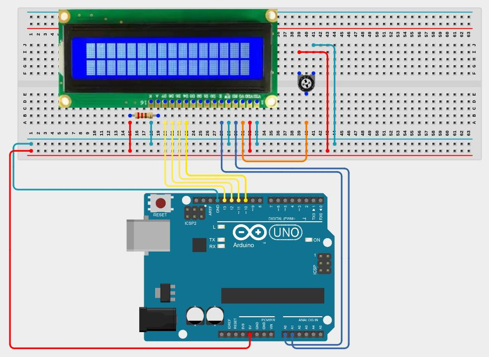

# LCD Library

# Functions

```
void initialize_lcd()
void print_char(char character)
void print_string(char word[])
void clear_display()
void move_cursor_to_position(int row, int column)
void show_cursor(bool show)
void blink_cursor(bool blink)
void shift_cursor_left()
void shift_cursor_right()

```

For the move_cursor_to_position function, note that row and column start at 0, not 1. So, the first row would be 0 and the first column would be 0. The maximum row is 1 and the maximum column is 15.

# Schematic



# Library

```
const int lcd_enable_pin = A0;
const int lcd_rs_pin = A1;

const int lcd_d4_pin = 10;
const int lcd_d5_pin = 11;
const int lcd_d6_pin = 12;
const int lcd_d7_pin = 13;


struct lcd_data
{
  bool display_on;
  bool show_cursor;
  bool blink_cursor;
  bool cursor_autoscroll;
  bool screen_shift;
};

struct lcd_data lcd_data_state =
{
  false,
  false,
  false,
  false,
  false
};

void write_command(uint8_t command)
{
  uint8_t masked_command = command & 0b00001111;
  digitalWrite(lcd_d4_pin, masked_command & 0b00000001);
  digitalWrite(lcd_d5_pin, masked_command & 0b00000010);
  digitalWrite(lcd_d6_pin, masked_command & 0b00000100);
  digitalWrite(lcd_d7_pin, masked_command & 0b00001000);

  digitalWrite(lcd_enable_pin, HIGH);

  delayMicroseconds(1);

  digitalWrite(lcd_enable_pin, LOW);

  delayMicroseconds(100);
}

void clear_display()
{
  write_command(0b0000);
  write_command(0b0001);
}

void turn_display_on(bool on)
{
  lcd_data_state.display_on = on;
  uint8_t command = 0b00001000;
  command |= (lcd_data_state.display_on << 2);
  command |= (lcd_data_state.show_cursor << 1);
  command |= (lcd_data_state.blink_cursor);

  write_command(command >> 4);
  write_command(command);
}

void enable_cursor_autoscroll(bool enable)
{
  lcd_data_state.cursor_autoscroll = enable;
  uint8_t command = 0b00000100;
  command |= (lcd_data_state.cursor_autoscroll << 1);
  command |= (lcd_data_state.screen_shift);

  write_command(command >> 4);
  write_command(command);
}

void initialize_lcd()
{
  pinMode(lcd_d4_pin, OUTPUT);
  pinMode(lcd_d5_pin, OUTPUT);
  pinMode(lcd_d6_pin, OUTPUT);
  pinMode(lcd_d7_pin, OUTPUT);
  pinMode(lcd_enable_pin, OUTPUT);
  pinMode(lcd_rs_pin, OUTPUT);

  digitalWrite(lcd_rs_pin, LOW);

  delay(15);
  write_command(0b0011);
  delay(5);
  write_command(0b0011);
  delay(1);
  write_command(0b0011);

  write_command(0b0010);

  write_command(0b0010);
  write_command(0b1000);
  
  turn_display_on(true);
  clear_display();
  enable_cursor_autoscroll(true);
  
  delay(100);
}

void print_char(char character)
{
  digitalWrite(lcd_rs_pin, HIGH);
  uint8_t command = (uint8_t)character;
  write_command(command >> 4);
  write_command(command);
  digitalWrite(lcd_rs_pin, LOW);
}

void print_string(char word[])
{
  for (int i = 0; i < strlen(word); i++)
  {
    print_char(word[i]);
  }
}

void move_cursor_to_position(int row, int column)
{
  if (row > 1)
  {
    row = 1;
  }
  else if (row < 0)
  {
    row = 0;
  }

  if (column > 15)
  {
    column = 15;
  }
  else if (column < 0)
  {
    column = 0;
  }

  uint8_t command = 0b10000000 | ((row << 6) + column);
  write_command(command >> 4);
  write_command(command);
}

void show_cursor(bool show)
{
  lcd_data_state.show_cursor = show;
  uint8_t command = 0b00001000;
  command |= (lcd_data_state.display_on << 2);
  command |= (lcd_data_state.show_cursor << 1);
  command |= (lcd_data_state.blink_cursor);

  write_command(command >> 4);
  write_command(command);
}

void blink_cursor(bool blink)
{
  lcd_data_state.blink_cursor = blink;
  uint8_t command = 0b00001000;
  command |= (lcd_data_state.display_on << 2);
  command |= (lcd_data_state.show_cursor << 1);
  command |= (lcd_data_state.blink_cursor);

  write_command(command >> 4);
  write_command(command);
}

void enable_screen_shift(bool enable)
{
  lcd_data_state.screen_shift = enable;
  uint8_t command = 0b00000100;
  command |= (lcd_data_state.cursor_autoscroll << 1);
  command |= (lcd_data_state.screen_shift);

  write_command(command >> 4);
  write_command(command);
}

void shift_cursor_left()
{
  uint8_t command = 0b00010000;
  write_command(command >> 4);
  write_command(command);
}

void shift_cursor_right()
{
  uint8_t command = 0b00010100;
  write_command(command >> 4);
  write_command(command);
}

void shift_display_left()
{
  uint8_t command = 0b00011000;
  write_command(command >> 4);
  write_command(command);
}

void shift_display_right()
{
  uint8_t command = 0b00011100;
  write_command(command >> 4);
  write_command(command);
}

void setup()
{
  initialize_lcd();
  print_string("Hello World!");
}

char character = '!';
void loop()
{
  character++;
  move_cursor_to_position(1, 0);
  print_char(character);
  if (character == '~')
  {
    character = '!';
  }
  delay(1000);
}

```