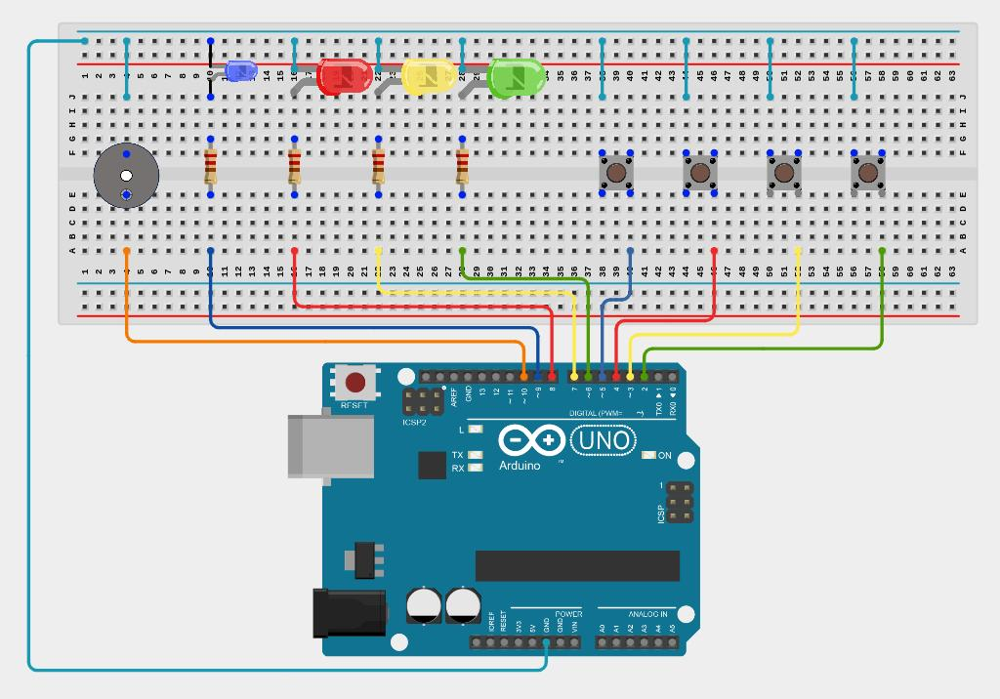

# Memory Game

## Passive Buzzer

Look at [Lesson 7](../../lessons/07_arrays/README.md) at the section about passive buzzers.

# Requirements

For the memory game, there should be four LEDs, four buttons, and a buzzer. LEDs will turn on and off in a random sequence. After the sequence completes, the person playing the game must press buttons in the same sequence as the LEDs. If the correct sequence is entered using the buttons, all four LEDs should flash on and off briefly to indicate success. If the sequence was entered incorrectly, only the blue and green LED should turn on briefly to indicate failure. Whenever a LED flashes or a button is pressed, the buzzer should make a sound unique to the color of LED or button.

There should be a total of 10 levels. For the first level, just one LED should turn on. For level 2, two LEDs should turn on, one after the other. This pattern should continue so that there are a total of 10 levels. If the sequence is ever entered incorrectly, the game starts over at level 1. If level 10 is completed, then the LEDs should quickly turn on and off to celebrate beating the game until a button is pressed. Once a button is pressed, then the game resets back at level 1.

Below is the schematic for this project.



A template is provided below. Most of it is complete. Go through and replace comments with the suggested code.

```
const int green_button_pin = 2;
const int yellow_button_pin = 3;
const int red_button_pin = 4;
const int blue_button_pin = 5;
const int green_led_pin = 6;
const int yellow_led_pin = 7;
const int red_led_pin = 8;
const int blue_led_pin = 9;
const int buzzer_pin = 10;
const int total_levels = 10;

const int yellow_sound_frequency = 277;
const int red_sound_frequency = 220;
const int green_sound_frequency = 330;
const int blue_sound_frequency = 165;

const int sound_duration = 300;
const int led_on_off_duration = 500;
const int delay_duration = led_on_off_duration - sound_duration;

int led_sequence[100];
int button_sequence[100];
int level = 1;

struct buttons
{
  int yellow;
  int red;
  int green;
  int blue;
};

void generate_sound(int pin, int frequency, unsigned long duration_milliseconds)
{
  unsigned long start_time = millis();

  int half_period = 1000000 / (2 * frequency);

  while ((millis() - start_time) < duration_milliseconds)
  {
    digitalWrite(pin, HIGH);
    delayMicroseconds(half_period);
    digitalWrite(pin, LOW);
    delayMicroseconds(half_period);
  }
}

void light_led(int pin)
{
  if (pin == yellow_led_pin)
  {
    digitalWrite(yellow_led_pin, HIGH);
    generate_sound(buzzer_pin, yellow_sound_frequency, sound_duration);
    delay(delay_duration);
    digitalWrite(yellow_led_pin, LOW);
  }
  else if (pin == red_led_pin)
  {
    digitalWrite(red_led_pin, HIGH);
    // use generate sound function to make a sound for the red led
    delay(delay_duration);
    digitalWrite(red_led_pin, LOW);
  }
  else if (pin == green_led_pin)
  {
    digitalWrite(green_led_pin, HIGH);
    generate_sound(buzzer_pin, green_sound_frequency, sound_duration);
    delay(delay_duration);
    digitalWrite(green_led_pin, LOW);
  }
  else if (pin == blue_led_pin)
  {
    digitalWrite(blue_led_pin, HIGH);
    // use generate sound function to make a sound for the blue led
    delay(delay_duration);
    digitalWrite(blue_led_pin, LOW);
  }
}

void generate_sequence(int sequence[], int level)
{
  for (int i = 0; i < level; i++)
  {
    sequence[i] = random(6, 10);
  }
}

void erase_sequence(int sequence[], int level)
{
  for (int i = 0; i < level; i++)
  {
    sequence[i] = 0;
  }
}

bool sequences_equal(int sequence_1[], int sequence_2[], int level)
{
  int equal = true;
  for (int i = 0; i < level; i++)
  {
    if (sequence_1[i] != sequence_2[i])
    {
      equal = false;
    }
  }

  return equal;
}

void show_sequence(int sequence[], int level)
{
  for (int i = 0; i < level; i++)
  {
    light_led(sequence[i]);
    delay(led_on_off_duration);
  }
}

void show_success()
{
  digitalWrite(yellow_led_pin, HIGH);
  digitalWrite(red_led_pin, HIGH);
  digitalWrite(green_led_pin, HIGH);
  digitalWrite(blue_led_pin, HIGH);
  delay(led_on_off_duration);
  digitalWrite(yellow_led_pin, LOW);
  digitalWrite(red_led_pin, LOW);
  digitalWrite(green_led_pin, LOW);
  digitalWrite(blue_led_pin, LOW);
  delay(led_on_off_duration);
}

void show_failure()
{
  digitalWrite(yellow_led_pin, HIGH);
  digitalWrite(blue_led_pin, HIGH);
  delay(led_on_off_duration);
  digitalWrite(yellow_led_pin, LOW);
  digitalWrite(blue_led_pin, LOW);
  delay(led_on_off_duration);
}

void game_won_loop()
{
  struct buttons current_button_states;
  struct buttons previous_button_states;

  bool button_released = false;

  while (!button_released)
  {
    digitalWrite(yellow_led_pin,HIGH);
    delay(100);
    digitalWrite(yellow_led_pin, LOW);
    digitalWrite(red_led_pin,HIGH);
    delay(100);
    digitalWrite(red_led_pin, LOW);
    digitalWrite(green_led_pin,HIGH);
    delay(100);
    digitalWrite(green_led_pin, LOW);
    digitalWrite(blue_led_pin,HIGH);
    delay(100);
    digitalWrite(blue_led_pin, LOW);

    previous_button_states = current_button_states;
    current_button_states.yellow = digitalRead(yellow_button_pin);
    current_button_states.red = digitalRead(red_button_pin);
    current_button_states.green = digitalRead(green_button_pin);
    current_button_states.blue = digitalRead(blue_button_pin);

    if (current_button_states.yellow == HIGH && previous_button_states.yellow == LOW)
    {
      button_released = true;
    }
    else if (current_button_states.red == HIGH && previous_button_states.red == LOW)
    {
      button_released = true;
    }
    else if (current_button_states.green == HIGH && previous_button_states.green == LOW)
    {
      button_released = true;
    }
    else if (current_button_states.blue == HIGH && previous_button_states.blue == LOW)
    {
      button_released = true;
    }
  }

  digitalWrite(yellow_led_pin, LOW);
  digitalWrite(red_led_pin, LOW);
  digitalWrite(green_led_pin, LOW);
  digitalWrite(blue_led_pin, LOW);
}

void setup()
{
  pinMode(yellow_led_pin, OUTPUT);
  pinMode(red_led_pin, OUTPUT);
  pinMode(green_led_pin, OUTPUT);
  pinMode(blue_led_pin, OUTPUT);
  pinMode(yellow_button_pin, INPUT_PULLUP);
  pinMode(red_button_pin,INPUT_PULLUP);
  pinMode(green_button_pin, INPUT_PULLUP);
  pinMode(blue_button_pin, INPUT_PULLUP); 
  pinMode(buzzer_pin, OUTPUT);
  randomSeed(analogRead(0));
  generate_sequence(led_sequence, level);
}

void loop()
{
  struct buttons current_button_states;
  struct buttons previous_button_states;

  current_button_states.yellow = 1;
  current_button_states.red = 1;
  current_button_states.green = 1;
  current_button_states.blue = 1;

  previous_button_states.yellow = 1;
  previous_button_states.red = 1;
  previous_button_states.green = 1;
  previous_button_states.blue = 1;

  show_sequence(led_sequence, level);

  for (int i = 0; i < level; i++)
  {
    previous_button_states = current_button_states;
    current_button_states.yellow = // read the yellow button pin
    current_button_states.red = // read the red button pin
    current_button_states.green = // read the green button pin
    current_button_states.blue = // read the blue button pin

    if (// condition when yellow button is released)
    {
      button_sequence[i] = yellow_led_pin;
      generate_sound(buzzer_pin, yellow_sound_frequency, sound_duration);
    }
    else if (// condition when red button is released)
    {
      button_sequence[i] = red_led_pin;
      generate_sound(buzzer_pin, red_sound_frequency, sound_duration);
    }
    else if (// condition when green button is released)
    {
      button_sequence[i] = green_led_pin;
      generate_sound(buzzer_pin, green_sound_frequency, sound_duration);
    }
    else if (// condition when blue led is released)
    {
      button_sequence[i] = blue_led_pin;
      generate_sound(buzzer_pin, blue_sound_frequency, sound_duration);
    }
    else
    {
      i--;
      delay(10);
    }
  }
  
  if (sequences_equal(led_sequence, button_sequence, level))
  {
    erase_sequence(led_sequence, level);
    erase_sequence(button_sequence, level);
    if (level == total_levels)
    {
      // use game won loop function
      // set the level to 1
    }
    else
    {
      // use show success function
      // increase the level by 1
    }

    generate_sequence(led_sequence, level);
  }
  else
  {
    // use show failure function
    erase_sequence(button_sequence, level);
    erase_sequence(led_sequence, level);
    // set the level to 1
    generate_sequence(led_sequence, level);
  }
}

```
